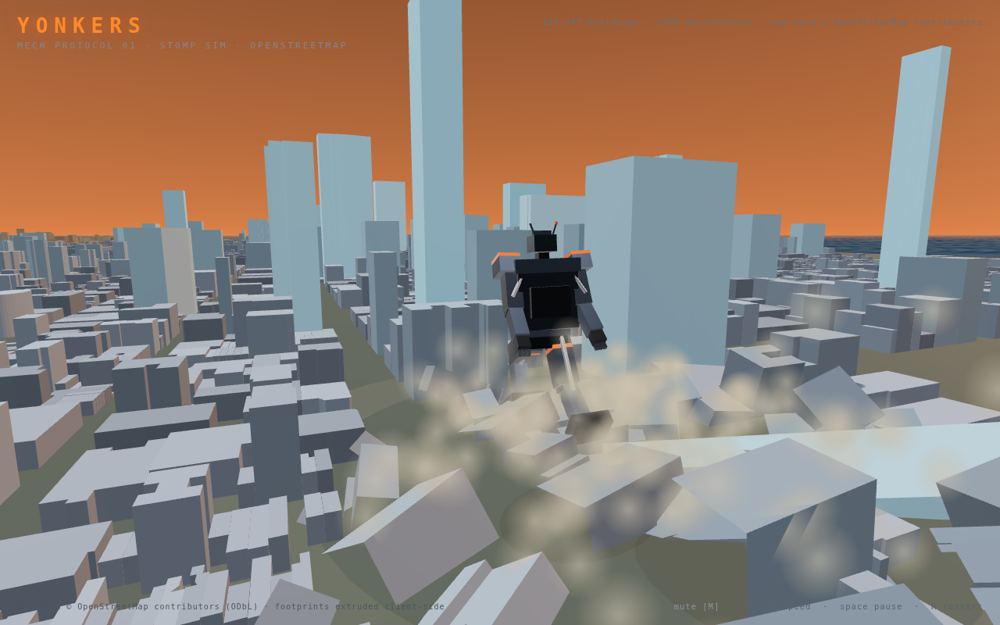

# YONKERS // mech protocol

A Three.js animation: the mech **Yonkers** powers up on the Yonkers
waterfront, performs a staged hydraulic stand-up and then stomps through
the Bronx and down Manhattan, across the East River into Brooklyn and on
through Queens to Flushing Meadows. The city is real: every footprint,
island outline and building height comes from OpenStreetMap. The mech
rises on Yonkers, across the river north of the city proper - which is
where its name comes from.



## Run it

```bash
python3 tools/fetch_osm.py   # once: OSM data -> data/city.json (~1-3 min when Overpass is kind)
./run.sh                     # serves http://localhost:8123
```

Then open <http://localhost:8123> (or a specific time with
`http://localhost:8123/?t=15.5` to jump straight to the roar).
In-scene keys: `1/2/4` playback speed, `space` pause, `M` mute, `R` restart.

## The scene

- **Data** (`tools/fetch_osm.py`): borough boundary relations
  (Manhattan, Brooklyn, Queens, Bronx, plus the City of Yonkers) and all
  `building=*` ways from
  Overpass, filtered (tiny footprints dropped in the outer boroughs),
  deduplicated, assigned to boroughs by point-in-polygon, projected to a
  local Web-Mercator metre grid and written to `data/city.json`. Raw
  Overpass responses stay cached in `data/raw/` so reruns are offline.
- **City** (`app/city.js`): footprints extruded by their OSM `height` /
  `building:levels` (borough-typical defaults otherwise), merged into
  1.5 km grid cells with flat shading and per-borough vertex colours.
  Buildings within 260 m of the route stay individual meshes so they can
  topple on footfalls.
- **Mech** (`app/mech.js`): ~150 m box-rig with hips, knees, ankles,
  torso, shoulders, elbows and a scanning head; hydraulic pistons are
  live struts stretched between their anchors. The stand-up is a
  keyframed timeline (crouch → push-off → knee surge → overshoot →
  settle → vent plates → roar) with per-joint delays so the machine
  deploys in a cascade.
- **Choreography** (`app/main.js`, `app/route.js`): rise → roar → stomp
  south with stride-length footsteps; long stretches north of midtown are
  bridged by white-flash jump cuts ("SECTOR // MIDTOWN" ...). Camera
  director: orbit during the rise, chase while stomping, a ground camera
  at every seventh footfall, crane orbit for the final pose. Footfalls
  drive camera trauma shake, shockwave rings, dust, footprint decals,
  collapsing buildings and a WebAudio thud on top of a hydraulic rumble
  bed.
- **Test hook**: `?t=15.5` seeks the simulation deterministically and
  `window.YONKERS.seek(t)` does the same from the console; the headless
  screenshots in `docs/` are made with these.

## Credits

Map data © [OpenStreetMap](https://www.openstreetmap.org/copyright)
contributors, ODbL. Rendered with [three.js](https://threejs.org/).
